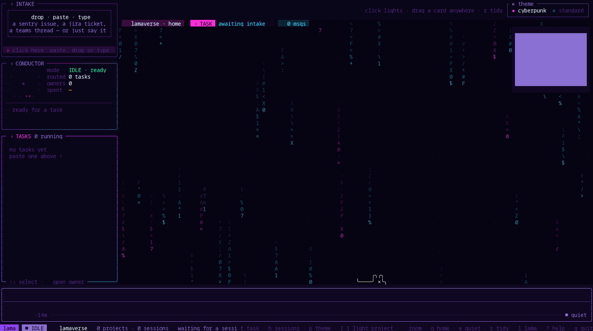

<p align="center">
  
</p>

<h1 align="center">lama</h1>

<p align="center">
  <em>Mission control for your coding agents: every Claude Code and Codex session on one live map, in your terminal.</em>
</p>

<p align="center">
  <a href="#installation">Install</a> ·
  <a href="#what-lama-does">What it does</a> ·
  <a href="#the-lamaverse">Lamaverse</a> ·
  <a href="#talk-to-your-agents-the-session-console">Console</a> ·
  <a href="#tasks-one-ticket-a-team-of-agents">Tasks</a> ·
  <a href="#keys">Keys</a>
</p>



<sub>The recording replays lama's bundled sample sessions live: four projects, Claude
Code and Codex side by side, subagents and workflow lanes filling in as they work.
Then a project is lit and zoomed into, and the theme switches from cyberpunk to
standard and back.</sub>

## Why

Run a few Claude Code and Codex sessions at once and they scatter across terminal
tabs. You lose track of which one is working, which one finished, and which one has
been sitting on a permission prompt for ten minutes.

Both agents write a transcript for every session. **lama** reads those transcripts
and draws every session as a live graph: the main agent, the subagents it spawns,
the tools each one runs. It puts all your projects on one canvas, the
**lamaverse**, so you see everything at a glance. From there you can talk to any
session, answer its approval prompts, start new sessions, and hand a whole ticket to
a team of agents.

Watching is read-only and stays on your machine. Acting on a session (typing,
answering, launching) goes through the agent's own terminal window, exactly as if
you had typed it there.

## What lama does

| | |
| --- | --- |
| **See** | Every session as a graph: agents, subagents, workflow groups, live tool calls, tokens, status. All your projects on one map. |
| **Replay** | Scrub back through any session, finished or running. Seek backwards and the graph un-happens exactly. |
| **Notice** | A card blinks red when an agent waits on your approval and green when it finishes its turn. The lama mascot ropes over to it. |
| **Talk** | Open a session's console on the canvas: its whole conversation, a prompt line that types into the agent's terminal, its approval questions as clickable choices. |
| **Start** | New Claude or Codex sessions in any project, from the canvas. Resume closed ones from the sessions drawer. |
| **Delegate** | Paste a ticket or a sentence. A conductor agent picks the projects, you pick who runs each part, and lama launches the team in their own git worktrees, wired to a message bus. |

Supported agents:

| Agent | Sessions are read from | Replay | Live | Console and launching |
| --- | --- | --- | --- | --- |
| [Claude Code](https://claude.com/claude-code) | `~/.claude/projects/` | ✓ | ✓ | ✓ |
| [Codex](https://openai.com/codex/) CLI and desktop app | `~/.codex/sessions/` | ✓ | ✓ | ✓ (CLI) |

You need only one of them. lama finds which agent CLIs you have and offers only those.

## Installation

### Requirements

- **Linux or macOS** for the full feature set. On Windows lama views and replays
  sessions; see [Platforms](#platforms).
- **Rust 1.88 or newer** to build ([rustup](https://rustup.rs)).
- **Claude Code and/or Codex** installed, for there to be sessions to show.
- A terminal with truecolor and mouse support. **[kitty](https://sw.kovidgoyal.net/kitty/)**
  or **[tmux](https://github.com/tmux/tmux)** unlocks the interactive features (console,
  approvals, launching, tasks). Any terminal works for viewing.
- A font with box-drawing and symbol glyphs (Noto Sans Mono, JetBrains Mono, any Nerd Font).

### Install with Cargo

```bash
cargo install --git https://github.com/AmalRNambiar/lama --locked
```

This builds the `lama` command into `~/.cargo/bin`. Make sure that's on your `PATH`.

### Or build from source

```bash
git clone https://github.com/AmalRNambiar/lama
cd lama
cargo build --release
./target/release/lama --lamaverse
```

### Set up kitty (recommended)

lama reaches an agent's window through kitty's remote control. Add these two lines
to `~/.config/kitty/kitty.conf` and restart kitty:

```text
allow_remote_control socket-only
listen_on unix:/tmp/kitty-{kitty_pid}
```

`socket-only` keeps remote control to programs running as you on this machine.
Run lama and your agents in kitty windows or tabs, and lama finds each session's
window by itself.

### Or use tmux

No setup needed. Run your agents in tmux panes, in any terminal emulator, and lama
reaches them with `tmux send-keys` and `capture-pane`. For copying console text to
the clipboard through tmux, add `set -g set-clipboard on` to `~/.tmux.conf`.

### First run

```bash
lama --lamaverse              # every project with sessions in the last hour
lama --lamaverse --since 1d   # widen the window (s, m, h, d)
```

Run plain `lama` from your home directory and you get the lamaverse too. Run it
inside a project and it follows that project's sessions.

## The lamaverse

The lamaverse is one canvas with every project that has had a session recently.

- **Projects strip.** Across the top, one boxed chip per project with its agent count and
  how many are live. Click a chip, or press `[` `]`, to light a project up: its sessions get
  an outline in the project's colour and everything else dims. `◇ N quiet` brings
  idle projects onto the canvas too.
- **Session blocks.** Each session is a block: its main card with its subagents
  and workflow lanes underneath, updating live. Drag a card anywhere; it stays there
  across restarts. New sessions land next to their project's newest one, and
  nothing else moves to make room. `r` tidies everything back into project clusters.
- **Timeline.** Along the bottom, one lane per project with recent tool activity
  and a feed of the latest calls.
- **Attention.** A card blinks red when its agent is waiting on a permission prompt
  and green when it has finished its turn and you haven't looked yet. A session
  that starts asking opens its console in place on its own.
- **The lama.** A small lama lives on the cards. He walks their top edges, jumps
  between them, shoots a rope arrow to swing to farther ones, and now and then
  slips and hangs by his hooves. When a session needs you he ropes over and waves
  `psst!` until you answer. When one finishes he does a victory bounce on it. `l` hides
  him.
- **Themes.** Neon **cyberpunk** is the default. Click **standard** in the `◐ theme`
  box at the top right, or press `p`, for quiet slate colours with the same
  animations. Your choice is remembered.

## Talk to your agents: the session console

Double-click a card (or select it and press `⏎`) and it grows into a console in
place: the session's whole conversation, newest at the bottom, with a prompt line.
Open as many as you like. Zoomed out, each one shrinks to its latest exchange.

- **Type and send.** What you type goes into the agent's own kitty window or tmux
  pane as if you'd typed it there. Its reply streams back into the console.
- **Answer approvals.** When the agent asks permission, the console shows the question
  and its choices. Press a choice's number or click it, and lama presses that key in
  the agent's window.
- **Control.** `⌃x` stops the running turn (Esc), `⌃t` jumps to the agent's window,
  `⌃r` resumes a closed session in a new tab, `esc` hands the keyboard back to the canvas.
- **Copy and paste.** Drag over text to copy it; `⌃v` or `⌃⇧v` pastes into the prompt line.
- **New session.** Zoom into a project and press `n` (or click `＋ new session`). Pick
  Claude or Codex with `tab`, type the first prompt, `⏎`. It opens in a new tab in the
  project folder without stealing focus, and its console appears on the canvas.
- **Sessions drawer.** Press `h`: every session lama has seen running, open or closed,
  with how it ended (finished, mid-turn, or waiting on you). `⏎` resumes a closed one
  on the model it ran on.

## Tasks: one ticket, a team of agents

Press `t` and hand lama a task: a Sentry issue, a Jira ticket, a pasted error, or a
plain sentence.

1. With both CLIs installed, lama asks right away who runs the task's agents: `1`
   Claude, `2` Codex, `3` the conductor picks per agent. You can then walk away.
2. A **conductor** agent reads it in the background (headless, read-only tools) and
   decides which of your projects it touches. It writes a self-contained brief for
   each project's **owner** agent. If it wants a tool outside its read-only set, it
   waits for you: the intake shows what it wants to run, `y` allows it, `n` refuses,
   or type why not. If it can't read the source, it asks you in the intake too.
3. lama starts each owner in its own tab. Every agent that writes code gets its own
   **git worktree and branch** (`<project>/.lama/worktrees/`, branch
   `lama/<task>/<name>`), so nothing touches your checkout.
4. Agents talk over a **message bus** (an MCP server that lama runs). An owner can ask
   for peers, such as a reviewer or a test writer, and lama launches them next to it.
   Messages fly between cards on the canvas.
5. The **TASKS** box tracks each task's owners, progress and cost. Owners report when
   their part is done.

Every agent still asks before it edits files or runs commands, just as in a normal
session. The conductor only dispatches: it never edits code, pushes, merges or deploys.

**Who conducts.** With both CLIs installed, your first task asks once (`1` Claude,
`2` Codex) and remembers the answer. A Claude conductor runs `claude -p` on Sonnet. A
Codex conductor runs `codex exec` sandboxed read-only and offline, so it reads tickets
through your Codex MCP servers rather than CLIs like `jira` or `gh`.

## Replay and inspect a single session

```bash
lama <file.jsonl>             # replay a session from the start (any of its files)
lama <id>                     # replay by session id, or a unique prefix
lama <file.jsonl> --follow    # open at the live edge
lama <file.jsonl> --speed 16  # playback speed (default 8)
lama inspect <file|id>        # print the session tree and exit, no TUI
```

- **Time travel.** One scrubbable timeline for live and finished sessions. It is indexed by
  event, so a busy minute gets room. Pause, step between prompts, or jump back to
  live. Seek backwards and agents un-finish and the graph shrinks back exactly as it was.
- **Inspection.** Click an agent to see what spawned it, its reasoning, its model, and
  every tool call with timings. `i` shows session info: permissions, edits, the last prompt.
- **Follow mode.** `f` hands the camera to the action, and it glides to whichever agent just
  did something.

## Keys

**Lamaverse**

| Key | Action |
| --- | --- |
| click a chip, `[` `]` | light a project up / step between projects |
| `⏎`, double-click | zoom into the project / open the selected session's console |
| `n` | new session in the zoomed project |
| `t` | hand lama a task |
| `h` | sessions drawer |
| `o` | back to the whole map |
| `e` | show quiet projects too |
| `r` | tidy the layout |
| `p` | switch theme (cyberpunk / standard) |
| `l` | hide / show the lama |
| `+` `-`, wheel | zoom |
| drag | pan the canvas, or move a card |
| `?` | help |
| `q` | quit |

**Console**

| Key | Action |
| --- | --- |
| `⏎` | send the prompt |
| `1`–`9`, click | answer the approval question |
| `⌃x` | stop the agent's turn |
| `⌃t` | jump to the agent's window |
| `⌃r` | resume a closed session |
| `esc` | give the keyboard back to the canvas |

**Single-session view:** `space` play/pause · `[` `]` previous/next prompt · `End`/`g` live
edge · `s` gap compression · `o`/`f` overview/follow · `tab` next agent · `i` info · `?` help.

## Configuration

| Setting | Effect |
| --- | --- |
| `~/.config/lama/config.json` | `{"theme": "standard"}` and `{"conductor": "claude"}`: written when you pick them in lama |
| `LAMA_THEME=standard\|cyberpunk\|classic` | pin a theme for this run (`classic` is the plain, motion-free look) |
| `LAMA_FX=off` | keep the theme, still all animation |
| `LAMA_NEWS=on` | the "night edition" (below), off by default |

**The night edition.** With `LAMA_NEWS=on`, when you're idle a neon envelope now and
then drifts down the canvas. Click it to read one of tonight's top Hacker News or
Lobsters stories, written up by Claude Haiku. It's the only feature that uses the
network, which is why it's off by default.

## Platforms

| | Linux | macOS | Windows |
| --- | --- | --- | --- |
| Lamaverse, replay, inspect | ✓ | ✓ | ✓ |
| Console, approvals, new sessions, sessions drawer, tasks | ✓ kitty or tmux | ✓ kitty or tmux | no |

lama finds running agents from `/proc` on Linux and from the kernel's process
table on macOS. On macOS it also finds `kitten` inside `/Applications/kitty.app`
when it isn't on your `PATH`, and pastes with `pbpaste`. macOS support is built
and tested in CI on every change but is newer than Linux's, so please
[report](https://github.com/AmalRNambiar/lama/issues) anything that doesn't
work there. Windows has no kitty or tmux to reach agents through, so lama only
views sessions there.

## Privacy and what lama writes

- **Reading is local.** lama reads transcripts from `~/.claude` and `~/.codex`, and
  nothing leaves your machine. There is no HTTP client in its dependencies.
- **Typing is explicit.** lama types into an agent's window only when you send a prompt,
  answer a question, stop a turn, or deliver a task's bus message. It never answers a
  permission prompt on its own.
- **Files it writes:**
  - `~/.config/lama/`: your layout, theme and conductor choice.
  - `~/.local/share/lama/sessions/`: a record of the sessions it saw running, kept 30
    days, for the sessions drawer.
  - `~/.local/share/lama/tasks/`: each task's plan, messages and logs.
  - `<project>/.lama/worktrees/`: task agents' worktrees, excluded from git status.

## How it works

lama treats each transcript as an **append-only event log**. It tails the files,
parses every line defensively, and folds them into a model of agents, tool calls and
prompts. The model is a pure function of the lines seen so far, so seeking backwards is
exact and a live session and a recording use the same code.

- **Two clocks.** The playhead runs on the session's own timestamps. Animation runs on
  wall time. Speed and scrubbing change how the playhead moves, never what happened.
- **Ground truth over guesses.** Parentage, completion and naming come from what the
  formats record (a subagent's `toolUseId`, a workflow's `runId`), not from string
  matching.
- **Portable core.** The model, timeline and rendering are a library with no IO that
  also compiles to WebAssembly (`web/wasm/`). The terminal app adds file tailing,
  process discovery and the kitty/tmux bridge.

The transcript formats are internal to Claude Code and Codex and can change without
notice. lama skips records it doesn't recognise instead of failing. If something renders
oddly after an agent update, please [open an issue](https://github.com/AmalRNambiar/lama/issues).

More detail: [`docs/ARCHITECTURE.md`](https://github.com/AmalRNambiar/lama/blob/main/docs/ARCHITECTURE.md) (invariants) and
[`docs/DESIGN.md`](https://github.com/AmalRNambiar/lama/blob/main/docs/DESIGN.md) (module map and transcript formats).

## Contributing

Pull requests are welcome.

- Run `cargo fmt`, `cargo clippy --all-targets` (no warnings) and `cargo test` before opening one.
- Commits follow [Conventional Commits](https://www.conventionalcommits.org/), e.g.
  `fix(tailer): fold appends at the live edge without rebuilding`.
- Support for another agent is one provider directory under `src/provider/`.
  [`docs/DISCOVERY.md`](https://github.com/AmalRNambiar/lama/blob/main/docs/DISCOVERY.md) explains what one needs.
- The browser build is a separate crate in `web/wasm/` (wasm32 only). Build it with
  `bash web/scripts/build-wasm.sh`.

## License

[MIT](https://github.com/AmalRNambiar/lama/blob/main/LICENSE). lama's own changes are © 2026 Amal R Nambiar; the code it inherits from
zoetrope stays © 2026 Furkan Kalaycioglu, under the same licence.

## Acknowledgements

- **[zoetrope](https://github.com/furkankly/zoetrope)** by
  [Furkan Kalaycioglu](https://github.com/furkankly). lama is a fork of it: the
  transcript parsers, the tailer, the session model, the flow graph and the browser
  build all started there.
- [ratatui](https://github.com/ratatui/ratatui), the terminal UI framework.
- [rataflow](https://github.com/furkankly/rataflow), the node-graph widget.
- [ratzilla](https://github.com/ratatui/ratzilla), the WebAssembly backend.
